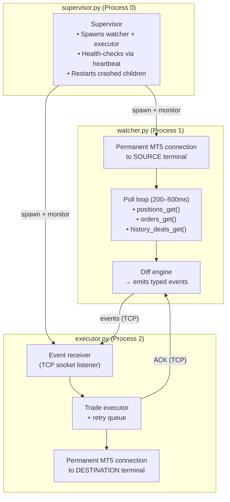
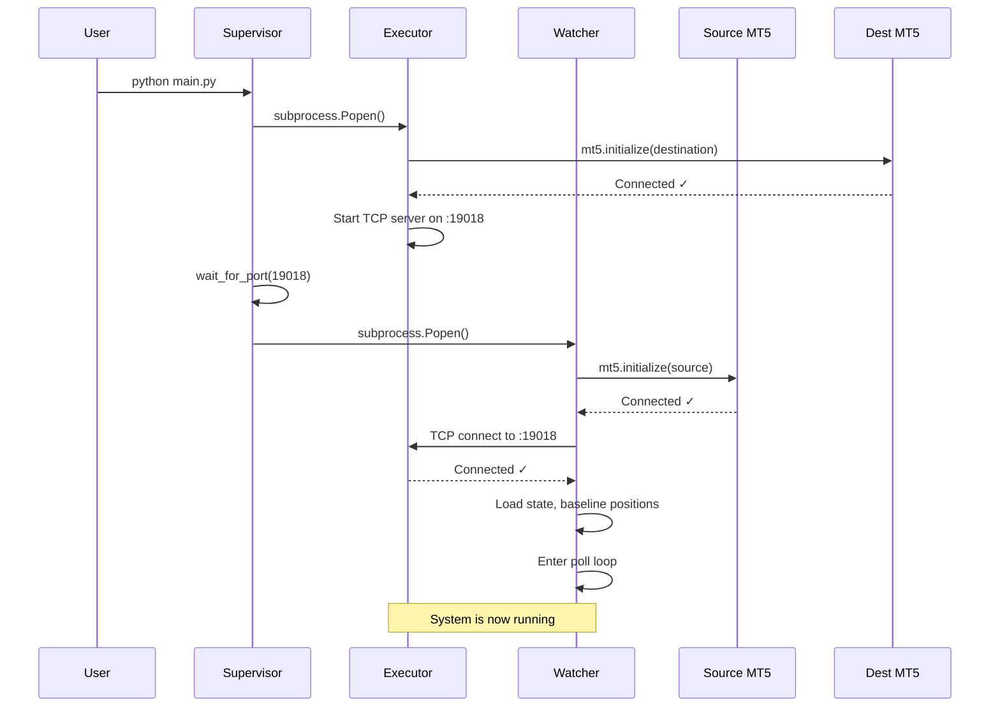

# MT5 Trade Copier v2 — Complete Implementation Plan

---

## 1. Executive Summary

Redesign the MT5 trade copier from a single-process, snapshot-polling architecture into a **dual-process event pipeline** with permanent MT5 connections. This eliminates the connect/disconnect overhead that dominates current latency, adds deal-history scanning to catch trades missed between polls, and introduces partial-close detection.

**Target outcomes:**
- Average sync latency: **200–400ms** (down from ~2.5s)
- Flash trade coverage: **100%** (up from 0%)
- Partial close handling: **Yes** (currently missing)
- Crash resilience: **Independent process restart** (currently: full restart required)

---

## 2. Problem Analysis — Current Architecture

### 2.1 How it works today

```
┌─────────────── Single Process, Single Thread ───────────────┐
│                                                             │
│  1. mt5.initialize(source)       ← ~100–200ms               │
│  2. positions_get() + orders_get()  ← ~5ms                  │
│  3. mt5.shutdown()               ← ~50ms                    │
│  4. mt5.initialize(destination)  ← ~100–200ms               │
│  5. Compare snapshots, execute trades  ← ~10–50ms           │
│  6. mt5.shutdown()               ← ~50ms                    │
│  7. sleep(poll_seconds)          ← 2,000ms default           │
│                                                             │
│  Total cycle: ~2,300–2,500ms                                 │
│  Of which ~300–500ms is pure connection overhead              │
└─────────────────────────────────────────────────────────────┘
```

### 2.2 Specific bugs and gaps

| # | Issue | Severity | Root Cause |
|---|---|---|---|
| 1 | Trades that open and close within one poll cycle are **permanently missed** | **Critical** | Only `positions_get()` is checked — no deal history |
| 2 | Partial closes not detected — source reduces volume, destination keeps full size | **High** | `update_position()` only checks SL/TP, not volume |
| 3 | ~300–500ms wasted on reconnections every cycle | **Medium** | MT5 API: one terminal per process; current design uses one process |
| 4 | Poll floor of 1 second is arbitrary | **Low** | Hardcoded `max(1, ...)` with no technical reason |
| 5 | No execution confirmation/retry — failed trades are logged but not retried | **Medium** | Fire-and-forget execution |
| 6 | Single point of failure — any crash kills both source monitoring and destination execution | **Medium** | Single process |

---

## 3. Architecture Overview



---

## 4. Module Specifications

### 4.1 `copier/events.py` — Event Definitions

All events are Python `dataclasses` that serialize to/from JSON for IPC transport.

#### Base Event

```python
@dataclass
class Event:
    event_id: str          # UUID4, unique per event
    event_type: str        # Enum string (see table below)
    timestamp: float       # time.time() when event was created
    source_ticket: int     # Source account ticket number
```

#### Event Types

| Event Type | Additional Fields | Trigger |
|---|---|---|
| `POSITION_OPEN` | `symbol: str`, `direction: str` ("buy"/"sell"), `volume: float`, `sl: float`, `tp: float` | New ticket appears in `positions_get()` OR new deal in `history_deals_get()` with entry type DEAL_ENTRY_IN |
| `POSITION_CLOSE` | `close_volume: float` | Tracked ticket disappears from `positions_get()` OR deal with DEAL_ENTRY_OUT for full volume |
| `POSITION_PARTIAL_CLOSE` | `remaining_volume: float`, `closed_volume: float` | Position volume decreases between polls OR deal with DEAL_ENTRY_OUT for partial volume |
| `POSITION_MODIFY` | `sl: float`, `tp: float` | SL or TP changes on a tracked position |
| `ORDER_PLACE` | `symbol: str`, `order_type: int`, `volume: float`, `price: float`, `sl: float`, `tp: float`, `stoplimit: float` (optional) | New ticket appears in `orders_get()` |
| `ORDER_MODIFY` | `price: float`, `volume: float`, `sl: float`, `tp: float` | Price, volume, SL, or TP changes on a tracked pending order |
| `ORDER_CANCEL` | *(none extra)* | Tracked order ticket disappears from `orders_get()` |
| `HEARTBEAT` | `positions_count: int`, `orders_count: int`, `cycle_ms: float` | Emitted every N cycles (configurable) for supervisor health monitoring |

#### Acknowledgment

```python
@dataclass
class Ack:
    event_id: str              # References the original Event
    success: bool
    destination_ticket: int    # 0 if failed
    error: str                 # Empty if success
    timestamp: float
```

#### Serialization

- `Event.to_json() → str` — deterministic JSON, sorted keys
- `Event.from_json(str) → Event` — validates all required fields
- All float fields use 8 decimal places to avoid FP drift

---

### 4.2 `copier/watcher.py` — Source Monitor (Process 1)

#### Responsibilities
1. Connect to source MT5 terminal once at startup, stay connected
2. Poll `positions_get()`, `orders_get()`, and `history_deals_get()` in a tight loop
3. Run the diff engine to detect changes
4. Emit events to the executor via IPC
5. Receive ACKs and update state mappings
6. Send heartbeats to supervisor

#### Startup Sequence

```
1. Load config.json
2. Load state.json (or create empty state)
3. mt5.initialize(source terminal)  — retry up to 5 times with backoff
4. Verify account login matches config
5. Connect IPC socket to executor (retry until available)
6. If state.initialized == false:
     Record current positions/orders as baseline (do NOT emit events for them)
     Set state.initialized = true
7. Record last_history_time = now (only scan deals from this point forward)
8. Enter poll loop
```

#### Poll Loop (core cycle)

```
while not stopped:
    t0 = time.perf_counter()

    # 1. Read current state from source terminal
    positions = mt5.positions_get() or []
    orders = mt5.orders_get() or []
    deals = mt5.history_deals_get(last_deal_time, now) or []

    # 2. Diff against previous state → generate events
    events = diff_engine(prev_positions, positions,
                         prev_orders, orders,
                         deals, state)

    # 3. Send events to executor
    for event in events:
        ipc.send(event)

    # 4. Process ACKs received since last cycle
    for ack in ipc.recv_acks():
        apply_ack(ack, state)

    # 5. Update previous state
    prev_positions = positions
    prev_orders = orders
    last_deal_time = max(deal.time for deal in deals) if deals else last_deal_time

    # 6. Persist state periodically (every 10 cycles or on change)
    maybe_save_state(state)

    # 7. Heartbeat (every 30 cycles)
    maybe_send_heartbeat(positions, orders, t0)

    # 8. Sleep remainder of interval
    elapsed = time.perf_counter() - t0
    sleep(max(0, poll_interval - elapsed))
```

#### Diff Engine — Detailed Algorithm

##### Position Diffing

```
Input:  prev_positions (dict[ticket → position_dict])
        curr_positions (dict[ticket → position_dict])
        tracked (dict[source_ticket → mapping] from state)
Output: list[Event]

# Detect closes (was in prev, not in curr)
for ticket in prev_positions:
    if ticket not in curr_positions:
        if ticket in tracked:
            emit POSITION_CLOSE(source_ticket=ticket)

# Detect opens (in curr, not in prev, not in baseline)
for ticket in curr_positions:
    if ticket not in prev_positions and ticket not in baseline:
        emit POSITION_OPEN(...)

# Detect modifications (in both, values changed)
for ticket in curr_positions:
    if ticket in prev_positions and ticket in tracked:
        prev = prev_positions[ticket]
        curr = curr_positions[ticket]

        # Volume change → partial close
        if curr.volume < prev.volume:
            emit POSITION_PARTIAL_CLOSE(
                remaining_volume=curr.volume,
                closed_volume=prev.volume - curr.volume
            )

        # SL/TP change
        if curr.sl != prev.sl or curr.tp != prev.tp:
            emit POSITION_MODIFY(sl=curr.sl, tp=curr.tp)
```

##### Deal History Scanning (catches flash trades)

```
Input:  deals from history_deals_get(since_last_check)
        tracked positions

# Group deals by position_id
deal_groups = group_by(deals, key=deal.position_id)

for position_id, group in deal_groups:
    entry_deals = [d for d in group if d.entry == DEAL_ENTRY_IN]
    exit_deals  = [d for d in group if d.entry == DEAL_ENTRY_OUT]

    # Flash trade: both entry and exit exist, position NOT in current positions
    if entry_deals and exit_deals:
        if position_id not in curr_positions:
            # This trade opened and closed between polls
            for d in entry_deals:
                emit POSITION_OPEN(source_ticket=d.position_id, ...)
            for d in exit_deals:
                emit POSITION_CLOSE(source_ticket=d.position_id)

    # Entry deal for position that already appeared in position diff
    # → skip (already handled by position diffing)

    # Exit deal for tracked position that disappeared
    # → skip (already handled by position diffing)

    # Partial close: exit deal but position still exists with less volume
    if exit_deals and not entry_deals:
        if position_id in curr_positions and position_id in tracked:
            # Only emit if position diff didn't already catch it
            pass  # Position diff handles this via volume comparison
```

> [!NOTE]
> The deal history scan is a **safety net**, not the primary detection mechanism. Position/order diffing catches most changes; deal history catches the edge cases (flash trades, between-poll closes).

##### Order Diffing

```
# Same pattern as position diffing:
# - New ticket in curr but not prev → ORDER_PLACE
# - Ticket in prev but not curr → ORDER_CANCEL
# - Ticket in both, values differ → ORDER_MODIFY
#   (compare: price, volume_current, sl, tp)
```

---

### 4.3 `copier/executor.py` — Destination Executor (Process 2)

#### Responsibilities
1. Connect to destination MT5 terminal once at startup, stay connected
2. Listen for events on TCP socket
3. Execute trade operations for each event
4. Send ACK back to watcher for each event
5. Maintain a retry queue for failed executions
6. Send heartbeats to supervisor

#### Startup Sequence

```
1. Load config.json
2. mt5.initialize(destination terminal) — retry up to 5 times with backoff
3. Verify account login matches config
4. Start TCP socket server on configured port
5. Wait for watcher connection
6. Enter event processing loop
```

#### Event Processing

```
while not stopped:
    event = ipc.recv_event(timeout=1.0)

    if event is None:
        process_retry_queue()   # Retry previously failed events
        continue

    try:
        result = execute(event)
        ipc.send_ack(Ack(event_id=event.event_id, success=True,
                         destination_ticket=result.order))
    except RetryableError as e:
        retry_queue.append((event, retry_count=0, next_retry=now+1s))
        ipc.send_ack(Ack(event_id=event.event_id, success=False,
                         error=str(e)))
    except FatalError as e:
        log.error("Non-retryable failure: %s", e)
        ipc.send_ack(Ack(event_id=event.event_id, success=False,
                         error=str(e)))
```

#### Execution Logic per Event Type

| Event | Execution |
|---|---|
| `POSITION_OPEN` | `order_send(TRADE_ACTION_DEAL)` at current market price with deviation |
| `POSITION_CLOSE` | Look up destination ticket from state mapping → `order_send(TRADE_ACTION_DEAL)` opposite direction for full volume |
| `POSITION_PARTIAL_CLOSE` | Look up destination ticket → `order_send(TRADE_ACTION_DEAL)` opposite direction for `closed_volume` (adjusted by volume_multiplier) |
| `POSITION_MODIFY` | Look up destination ticket → `order_send(TRADE_ACTION_SLTP)` |
| `ORDER_PLACE` | `order_send(TRADE_ACTION_PENDING)` |
| `ORDER_MODIFY` | `order_send(TRADE_ACTION_MODIFY)` using destination order ticket |
| `ORDER_CANCEL` | `order_send(TRADE_ACTION_REMOVE)` using destination order ticket |

#### Retry Queue

- Max **3 retries** per event, with exponential backoff: 1s → 3s → 10s
- Retryable errors: timeout, requote, price changed, no connection (transient)
- Non-retryable errors: invalid volume, symbol not found, not enough money, trade disabled
- After max retries, event is logged as permanently failed and dropped

---

### 4.4 `copier/ipc.py` — Inter-Process Communication

#### Protocol

```
Transport:   TCP over 127.0.0.1
Port:        Configurable (default 19018)
Encoding:    UTF-8
Framing:     Newline-delimited JSON (\n terminated)
Direction:   Bidirectional on single connection
```

#### Message Format

```json
{"msg_type": "event", "payload": { ... event fields ... }}\n
{"msg_type": "ack",   "payload": { ... ack fields ... }}\n
```

#### Connection Handling

- Executor starts a TCP server, watcher connects as client
- If connection drops, watcher retries every 1 second
- Events generated while disconnected are queued in memory (max 1000 events, then oldest dropped with warning)
- Both sides send TCP keepalive

#### Classes

```python
class IpcSender:
    """Used by watcher to send events and receive ACKs."""
    def __init__(self, host: str, port: int): ...
    def connect(self) -> None: ...           # Blocking, retries
    def send_event(self, event: Event) -> None: ...
    def recv_acks(self) -> list[Ack]: ...    # Non-blocking, returns all available
    def close(self) -> None: ...

class IpcReceiver:
    """Used by executor to receive events and send ACKs."""
    def __init__(self, host: str, port: int): ...
    def start(self) -> None: ...             # Starts TCP server
    def recv_event(self, timeout: float) -> Event | None: ...
    def send_ack(self, ack: Ack) -> None: ...
    def close(self) -> None: ...
```

---

### 4.5 `copier/history.py` — Deal History Scanner

#### Purpose

Dedicated module for querying and interpreting `mt5.history_deals_get()`. Separated from the watcher because deal history parsing has its own complexity (deal types, entry types, grouping by position ID).

#### Key Functions

```python
def scan_deals(since: datetime, until: datetime) -> list[DealRecord]:
    """Fetch and parse deals from MT5 history.
    Filters to relevant deal types (DEAL_TYPE_BUY, DEAL_TYPE_SELL).
    Ignores balance operations, commissions, corrections."""

def detect_flash_trades(deals: list[DealRecord],
                        current_positions: dict[int, Any],
                        tracked: dict[str, Any]) -> list[Event]:
    """Identify trades that opened AND closed since last scan
    and were not caught by position diffing."""

def detect_partial_closes(deals: list[DealRecord],
                          current_positions: dict[int, Any],
                          prev_positions: dict[int, Any],
                          tracked: dict[str, Any]) -> list[Event]:
    """Identify partial close deals and compute closed volume."""
```

#### Deal Type Filtering

Only process these deal types:
- `DEAL_TYPE_BUY` — market buy (position open or close)
- `DEAL_TYPE_SELL` — market sell (position open or close)

Ignore:
- `DEAL_TYPE_BALANCE` — deposits/withdrawals
- `DEAL_TYPE_CREDIT` — credit operations
- `DEAL_TYPE_CHARGE` — fees
- `DEAL_TYPE_CORRECTION` — broker corrections
- `DEAL_TYPE_BONUS` — bonuses
- `DEAL_TYPE_COMMISSION` / `DEAL_TYPE_COMMISSION_DAILY` / `DEAL_TYPE_COMMISSION_MONTHLY`

#### Deal Entry Types

- `DEAL_ENTRY_IN` — position opened (or added to)
- `DEAL_ENTRY_OUT` — position closed (fully or partially)
- `DEAL_ENTRY_INOUT` — reverse (close existing + open opposite)
- `DEAL_ENTRY_OUT_BY` — close by opposite position

---

### 4.6 `copier/supervisor.py` — Process Manager (Process 0)

#### Responsibilities
1. Launch watcher and executor as subprocesses
2. Monitor health via heartbeat events
3. Restart crashed processes automatically
4. Provide clean shutdown on SIGINT/SIGTERM
5. Console/log output aggregation

#### Implementation

```python
def main():
    # 1. Load config
    config = load_config()

    # 2. Start executor FIRST (it's the TCP server)
    executor_proc = subprocess.Popen(
        [sys.executable, "-m", "copier.executor"],
        cwd=ROOT
    )

    # 3. Wait brief moment for executor socket to be ready
    wait_for_port(config.ipc_port, timeout=10)

    # 4. Start watcher (connects to executor)
    watcher_proc = subprocess.Popen(
        [sys.executable, "-m", "copier.watcher"],
        cwd=ROOT
    )

    # 5. Monitor loop
    while not stopped:
        if executor_proc.poll() is not None:
            log.warning("Executor exited (code %s), restarting...", executor_proc.returncode)
            executor_proc = restart_executor()
        if watcher_proc.poll() is not None:
            log.warning("Watcher exited (code %s), restarting...", watcher_proc.returncode)
            watcher_proc = restart_watcher()
        sleep(2)

    # 6. Clean shutdown
    watcher_proc.terminate()
    executor_proc.terminate()
    watcher_proc.wait(timeout=10)
    executor_proc.wait(timeout=10)
```

#### Restart Policy

| Scenario | Action |
|---|---|
| Watcher crashes | Restart watcher; executor keeps running, queues incoming events |
| Executor crashes | Restart executor; watcher queues outgoing events in memory |
| Both crash | Restart both (executor first) |
| 3+ crashes in 60 seconds | Log critical error, stop (don't restart-loop) |
| MT5 terminal not responding | Subprocess will exit with error; supervisor restarts it |

---

### 4.7 `main.py` — Entry Point

```python
"""MT5 Trade Copier v2 — Entry Point"""
import sys
from copier.supervisor import main

if __name__ == "__main__":
    raise SystemExit(main())
```

Simple. All logic lives in the package.

---

## 5. State Management

### 5.1 `state.json` Schema

```json
{
  "version": 2,
  "initialized": true,
  "last_deal_time": 1729276800.0,
  "baseline_positions": ["12345", "12346"],
  "baseline_orders": ["67890"],
  "positions": {
    "12347": {
      "destination_ticket": 99001,
      "symbol": "EURUSD",
      "volume": 0.10,
      "direction": "buy",
      "copied_at": 1729276810.5
    }
  },
  "orders": {
    "67891": {
      "destination_ticket": 99002,
      "symbol": "GBPUSD",
      "price": 1.2650,
      "volume": 0.05,
      "copied_at": 1729276820.3
    }
  },
  "failed_events": [
    {
      "event_id": "abc-123",
      "event_type": "POSITION_OPEN",
      "source_ticket": 12348,
      "error": "Not enough money",
      "failed_at": 1729276830.0,
      "retries": 3
    }
  ]
}
```

### 5.2 Persistence Strategy

- **Watcher** owns the state file (single writer)
- Written atomically: write to `state.tmp` → rename to `state.json`
- Persisted every **10 poll cycles** or immediately on any state change (position/order mapping added/removed)
- On startup, state is loaded and validated; corrupt state falls back to re-initialization

### 5.3 Crash Recovery

| Scenario | Recovery |
|---|---|
| Watcher crashes mid-cycle | Restarts, reloads state.json, re-diffs current positions vs state — may re-emit events for unacknowledged changes |
| Executor crashes mid-execution | Trade may have been placed but ACK not sent. On restart, executor compares destination positions against state mappings to reconcile |
| Both crash simultaneously | Same as sequential recovery of each |
| state.json corrupted | Falls back to `initialized: false`, re-baselines. Existing destination positions are orphaned (logged as warning) |

### 5.4 Deduplication

Events carry a UUID `event_id`. The executor maintains an in-memory set of recently processed event IDs (last 10,000). If a duplicate arrives (watcher re-sent after crash), it is ignored and a success ACK is returned.

---

## 6. Configuration

### 6.1 `config.json` — Updated Format

Fully backward-compatible. New fields have defaults.

```json
{
  "source": {
    "login": 12345678,
    "password": "INVESTOR_PASSWORD",
    "server": "Broker-Server",
    "terminal_path": "C:\\Program Files\\MetaTrader 5 Source\\terminal64.exe"
  },
  "destination": {
    "login": 87654321,
    "password": "YOUR_TRADING_PASSWORD",
    "server": "Broker-Server",
    "terminal_path": "C:\\Program Files\\MetaTrader 5 Destination\\terminal64.exe"
  },

  "live_trading": false,
  "poll_ms": 500,
  "volume_multiplier": 1.0,
  "deviation_points": 20,
  "magic": 601018,
  "symbol_map": {
    "EURUSD.a": "EURUSD"
  },

  "ipc_port": 19018,
  "max_retries": 3,
  "heartbeat_every_n_cycles": 30,
  "state_save_every_n_cycles": 10,
  "max_event_queue_size": 1000
}
```

| Field | Default | Description |
|---|---|---|
| `poll_ms` | `500` | Watcher poll interval in milliseconds. Replaces `poll_seconds`. If `poll_seconds` is present and `poll_ms` is not, it is auto-converted (`poll_seconds × 1000`) for backward compatibility. |
| `ipc_port` | `19018` | Localhost TCP port for watcher ↔ executor communication |
| `max_retries` | `3` | Max execution retries per event before giving up |
| `heartbeat_every_n_cycles` | `30` | How often the watcher emits a heartbeat event |
| `state_save_every_n_cycles` | `10` | How often state.json is persisted (also saved on every mapping change) |
| `max_event_queue_size` | `1000` | Max events queued in memory when executor is disconnected |

---

## 7. Startup & Shutdown Sequences

### 7.1 Full Startup



### 7.2 Clean Shutdown

```
1. User sends Ctrl+C (SIGINT) or system sends SIGTERM
2. Supervisor catches signal, sets stop flag
3. Supervisor sends SIGTERM to watcher subprocess
4. Watcher:
   a. Sets stop flag, exits poll loop
   b. Saves state.json
   c. Closes IPC connection
   d. mt5.shutdown()
   e. Exits with code 0
5. Supervisor sends SIGTERM to executor subprocess
6. Executor:
   a. Sets stop flag
   b. Finishes processing current event (if any)
   c. Closes IPC server
   d. mt5.shutdown()
   e. Exits with code 0
7. Supervisor exits
```

---

## 8. Edge Cases

| # | Scenario | Handling |
|---|---|---|
| 1 | **Flash trade** (open+close within one poll) | Deal history scanner detects both DEAL_ENTRY_IN and DEAL_ENTRY_OUT for same position_id. Emits POSITION_OPEN then POSITION_CLOSE. Executor opens then immediately closes on destination. |
| 2 | **Partial close** | Volume diff detected by comparing curr.volume < prev.volume on same ticket. POSITION_PARTIAL_CLOSE event with exact closed_volume. Executor closes that volume on destination. |
| 3 | **Reverse position** (close buy, open sell in one operation) | Deal history shows DEAL_ENTRY_INOUT. Decomposed into POSITION_CLOSE for the old direction + POSITION_OPEN for the new direction. |
| 4 | **Source symbol doesn't exist on destination** | `symbol_map` translation applied. If destination symbol still not found, FatalError logged, event not retried, alert in logs. |
| 5 | **Destination rejects trade** (not enough margin) | FatalError, logged with full context. Event added to `failed_events` in state. Not retried (margin won't magically appear). |
| 6 | **Requote / price changed** | RetryableError, retried up to max_retries with fresh price on each retry. |
| 7 | **MT5 terminal disconnects mid-session** | `positions_get()` returns None → watcher catches exception, calls `mt5.shutdown()` + `mt5.initialize()` to reconnect. If reconnect fails 5 times, watcher exits (supervisor restarts it). |
| 8 | **Executor down, events queuing** | Watcher buffers up to `max_event_queue_size` events in memory. When executor reconnects, queued events are sent in order. If queue overflows, oldest events are dropped with critical log warning. |
| 9 | **Duplicate event after watcher restart** | Executor deduplicates by `event_id`. Already-processed events return cached ACK. |
| 10 | **State.json corrupted / deleted** | Watcher re-initializes: records current positions as baseline, starts fresh. Existing destination positions become "orphaned" — logged as warning. Manual reconciliation may be needed. |
| 11 | **Multiple pending orders placed simultaneously** | Each order gets its own ORDER_PLACE event. Events are processed sequentially by executor to avoid race conditions. |
| 12 | **Source uses netting, destination uses hedging (or vice versa)** | Not automatically handled. Documented as a requirement: both accounts should use the same position accounting mode. Mismatched modes logged as a startup warning. |

---

## 9. Error Handling Strategy

### 9.1 Error Classification

```python
class RetryableError(Exception):
    """Transient failure — retry may succeed."""
    # Examples: requote, timeout, no connection, trade context busy

class FatalError(Exception):
    """Permanent failure — do not retry."""
    # Examples: invalid volume, symbol not found, not enough money,
    #           trade disabled, market closed
```

### 9.2 MT5 Retcode Mapping

| Retcode | Classification | Action |
|---|---|---|
| `TRADE_RETCODE_DONE` | Success | ACK with destination ticket |
| `TRADE_RETCODE_DONE_PARTIAL` | Success | ACK (partial fill accepted) |
| `TRADE_RETCODE_PLACED` | Success | ACK (pending order placed) |
| `TRADE_RETCODE_REQUOTE` | Retryable | Retry with new price |
| `TRADE_RETCODE_REJECT` | Retryable | Retry after backoff |
| `TRADE_RETCODE_TIMEOUT` | Retryable | Retry after backoff |
| `TRADE_RETCODE_INVALID` | Fatal | Log and drop |
| `TRADE_RETCODE_INVALID_VOLUME` | Fatal | Log and drop |
| `TRADE_RETCODE_NO_MONEY` | Fatal | Log and drop |
| `TRADE_RETCODE_MARKET_CLOSED` | Retryable | Retry (market may reopen) |
| `TRADE_RETCODE_TRADE_DISABLED` | Fatal | Log and drop |
| All others | Fatal | Log and drop |

---

## 10. Logging

### 10.1 Log Levels

| Level | Usage |
|---|---|
| `DEBUG` | Raw event JSON, raw MT5 API responses, diff details |
| `INFO` | Trade copied, connection established, state saved, heartbeat |
| `WARNING` | Retry attempt, queue nearing capacity, orphaned positions |
| `ERROR` | Trade execution failed (fatal), MT5 reconnection failure |
| `CRITICAL` | Repeated crashes, queue overflow, state corruption |

### 10.2 Log Files

| File | Writer | Content |
|---|---|---|
| `watcher.log` | Watcher process | Source monitoring, diff results, events emitted |
| `executor.log` | Executor process | Events received, trade execution results, ACKs |
| `supervisor.log` | Supervisor | Process lifecycle, restarts, health status |

All three also write to stdout/stderr (captured by supervisor for console aggregation).

### 10.3 Log Format

```
2026-10-18 23:30:15.123 INFO [watcher] Copied POSITION_OPEN EURUSD buy 0.10 source=12347 event=abc-123
2026-10-18 23:30:15.245 INFO [executor] Executed POSITION_OPEN EURUSD buy 0.10 dest=99001 latency=122ms event=abc-123
```

Latency is logged on the executor side (event timestamp vs execution timestamp) for performance monitoring.

---

## 11. File-by-File Implementation Order

Implementation should proceed in this order, each step testable independently:

| Step | File | Est. Lines | Dependencies | Testable? |
|---|---|---|---|---|
| 1 | `copier/__init__.py` | 5 | — | — |
| 2 | `copier/events.py` | ~100 | — | ✅ Unit tests (serialization round-trip) |
| 3 | `copier/ipc.py` | ~180 | events.py | ✅ Unit tests (send/recv over localhost) |
| 4 | `copier/history.py` | ~120 | events.py | ✅ Unit tests (mock deal data) |
| 5 | `copier/watcher.py` | ~250 | events, ipc, history | ✅ Integration test with mock MT5 |
| 6 | `copier/executor.py` | ~220 | events, ipc | ✅ Integration test with mock MT5 |
| 7 | `copier/supervisor.py` | ~120 | — | ✅ Process lifecycle test |
| 8 | `main.py` | ~10 | supervisor | ✅ Smoke test |
| 9 | `run.bat` update | ~5 | main.py | — |
| **Total** | | **~1,010** | | |

---

## 12. Testing Strategy

### 12.1 Unit Tests (no MT5 required)

- `test_events.py` — Serialize/deserialize all event types, edge cases (zero SL/TP, max volume)
- `test_ipc.py` — Send/recv events and ACKs over localhost socket, connection drop/reconnect
- `test_history.py` — Flash trade detection, partial close detection from mock deal lists
- `test_diff.py` — Position diff, order diff with various scenarios (open, close, modify, partial close, no change)

### 12.2 Integration Tests (mock MT5)

- Create a `MockMT5` class that mimics `positions_get()`, `orders_get()`, `history_deals_get()`, `order_send()` with configurable responses
- Test full watcher cycle: inject mock positions → verify correct events emitted
- Test full executor cycle: inject events → verify correct `order_send()` calls made

### 12.3 Live Testing (real MT5, demo accounts)

1. Start in **monitor mode** (`live_trading: false`)
2. Manually place/modify/close trades on source demo account
3. Verify all events are correctly detected in watcher logs
4. Switch to `live_trading: true` on demo destination
5. Verify trades are replicated correctly
6. Test edge cases: rapid open/close, partial close, pending order lifecycle

---

## 13. Migration & Rollback

### 13.1 Migration Path

```
1. Build copier/ package alongside existing copier.py
2. Both coexist — old copier.py is not modified or deleted
3. Test new system with live_trading: false (monitor mode)
4. Compare event detection against source account activity
5. When confident, switch to live_trading: true
6. After stable operation (1+ week), old copier.py can optionally be archived
```

### 13.2 Rollback

```
1. Stop main.py (supervisor kills watcher + executor)
2. Run old copier.py — it reads the same config.json
3. Note: state.json v2 format is not backward-compatible with v1
   → Rename/backup state.json, let old copier.py create fresh state
   → Existing destination positions from v2 become unmanaged
```

---

## 14. Future Enhancements (post v2 launch)

| Priority | Enhancement | Description |
|---|---|---|
| P1 | **Web dashboard** | Tiny FastAPI server on localhost showing live positions, event log, latency stats, connection status |
| P1 | **Telegram/Discord alerts** | Notify on trade copies, failures, executor reconnections |
| P2 | **Multi-destination** | Fan out events to multiple executors (multiple destination accounts) |
| P2 | **Risk controls** | Max position size, daily loss limit, symbol whitelist/blacklist, max open positions |
| P3 | **Reconciliation tool** | CLI command that compares source and destination positions, flags mismatches, offers corrective actions |
| P3 | **Metrics / Prometheus** | Export cycle time, event throughput, execution latency, queue depth for monitoring |
